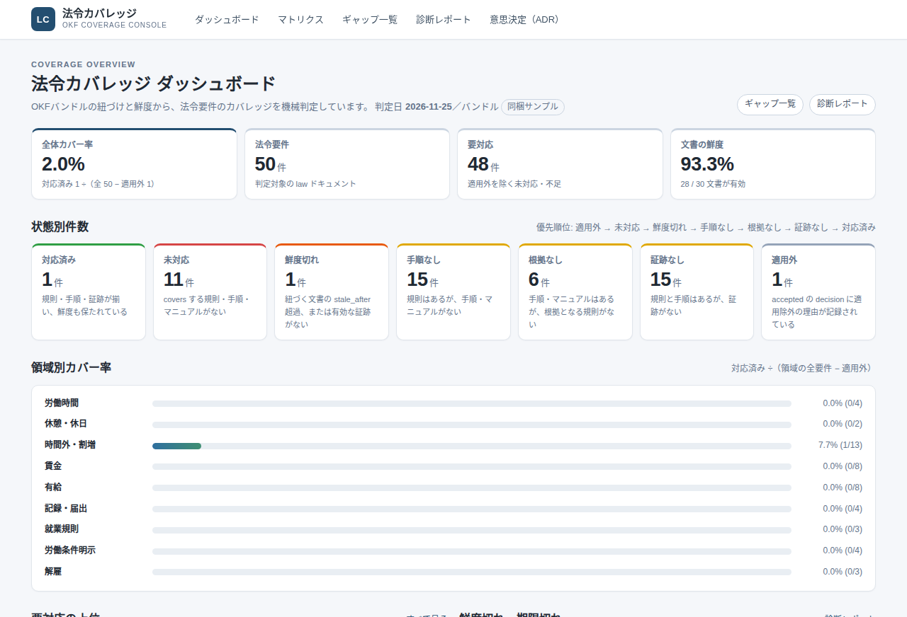

# 法令カバレッジ管理システム

法令要件（OKF バンドルの `type: law`）と社内文書（規則・手順・マニュアル・設定・証跡・意思決定）の紐づけから、カバレッジの過不足と鮮度を機械判定して可視化する Next.js アプリです。判定結果はダッシュボード、マトリクス、ギャップ一覧、診断レポートで確認できます。

**デモ:** https://law-coverage.vercel.app （同梱サンプルバンドル81件・労働基準法50要件の判定結果をそのまま表示）

**クローン:**
```bash
git clone https://github.com/nexaccept-dev/law-coverage.git
cd law-coverage
npm install
```


_同梱サンプルでの判定例：対応済み1件・未対応11件・手順なし15件・証跡なし15件など、不足の内訳が状態別に見える_

## 想定運用フロー

1. このリポジトリをクローンする。
2. `npm run init-bundle -- --out <dir>` で、法令ライブラリ（`bundle/` の `type: law`）だけを新しいバンドルに抽出する。
3. エージェント（Claude Code 等）に対象システムのパスとバンドルのパスを渡し、`AGENT-INSTRUCTIONS.md` の手順で調査・文書化させる。Claude Code では `/coverage-check <対象システムのパス>` も使える。
4. `npm run check -- --bundle <dir>` で形式とカバレッジを検証し、形式エラーを直す。
5. `BUNDLE_DIR=<dir> npm run dev`（または `npm run build`）でダッシュボードに充足率を表示する。

## コマンド

| コマンド | 説明 |
| --- | --- |
| `npm run dev` | 開発サーバーを起動する。バンドルは既定で `bundle/`、`BUNDLE_DIR` で切り替え可能。 |
| `npm run build` | 本番ビルド。 |
| `npm run check -- --bundle <dir> [--json]` | バンドルをチェックする。テキストまたは JSON で出力し、形式エラーが1件以上あれば終了コード1。 |
| `npm run init-bundle -- --out <dir> [--force]` | 既定バンドルから `type: law` のファイルだけを抽出し、`README.txt` とともに配置する。`--force` なしでは空でない既存ディレクトリを上書きしない。 |

### チェックの出力

テキスト出力にはバンドル名、判定日、充足率、状態別件数、設定でカバーされている要件の件数、ギャップ一覧（id／タイトル／状態／理由）、形式エラー一覧が出ます。`--json` は次の形です。

`.npmrc` で npm のログ出力を抑制しているため、`npm run check -- --bundle <dir> --json` の標準出力はそのまま JSON としてパースできます。

```json
{
  "bundle": "bundle",
  "today": "2026-11-24",
  "summary": { "total": 50, "coverageRate": 2.0, "counts": { "covered": 1, "missing": 11 } },
  "gaps": [{ "id": "law-lsa-006", "title": "法定休日の付与", "state": "stale", "reason": "..." }],
  "formatErrors": [{ "file": "rule-001.md", "message": "必須項目 verified がありません。" }],
  "laws": [{ "id": "law-lsa-001", "title": "法定労働時間（週）", "domain": "労働時間", "state": "no_evidence", "reason": "...", "viaSetting": false }]
}
```

## データ形式（OKF バンドル）

バンドルは Markdown ファイルを置いた1ディレクトリです。各ファイルは YAML frontmatter と本文からなります。

- 共通必須: `id` / `type` / `title` / `domain` / `verified`
- `type`: `law` / `rule` / `procedure` / `manual` / `setting` / `decision` / `evidence`
- `law`: `source`（法令名と条番号）、`source_url`
- `rule` / `procedure` / `manual` / `setting`: `covers`（対応する law の id 配列）
- `setting`: 設定でカバーできる要件に使い、設定の場所と内容を本文に書く（値の機械照合はしない）
- `evidence`: `supports`（law または rule の id 配列）、`expires`（任意）
- `decision`: `applies_to`（判断対象の id 配列）、`status`（`accepted` / `superseded`）、`supersedes`（任意）
- 鮮度: `stale_after`。この日を過ぎると鮮度切れ。

紐づけは社内文書側が `covers` / `supports` で law を指す一方向です。law 側は逆引きで集計します。判定ロジックの詳細は `SPEC.md` の「4. カバレッジ判定ロジック」を参照してください。

## ドキュメント

- `SPEC.md` — システム仕様と判定ロジック
- `AGENT-INSTRUCTIONS.md` — エージェントが調査・文書化するときの共通手順
- `.claude/commands/coverage-check.md` — Claude Code 用スラッシュコマンド
- `template/` — 新しい領域を始めるときのひな形

## ライセンス

MIT License（`LICENSE` を参照）
